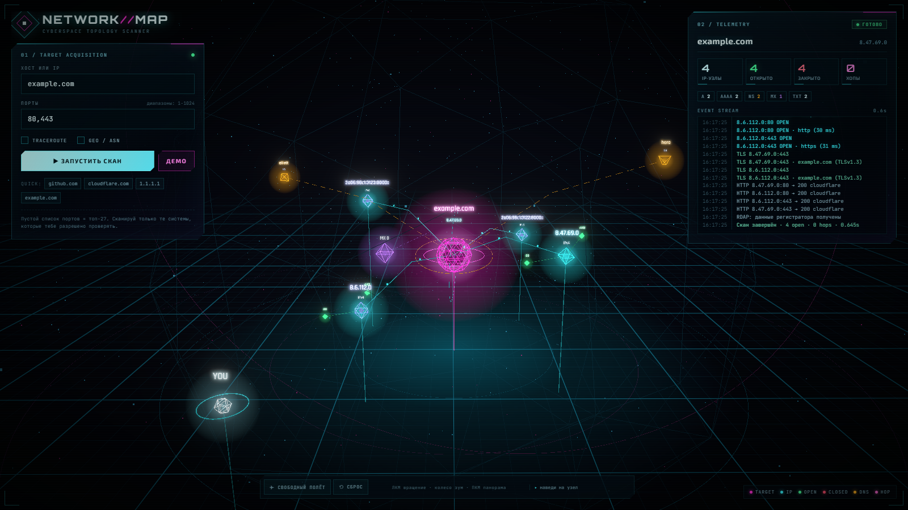
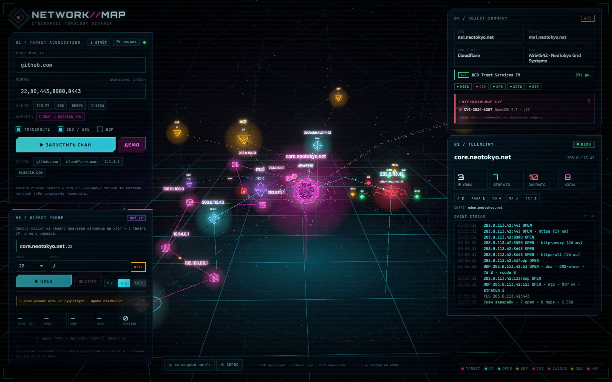
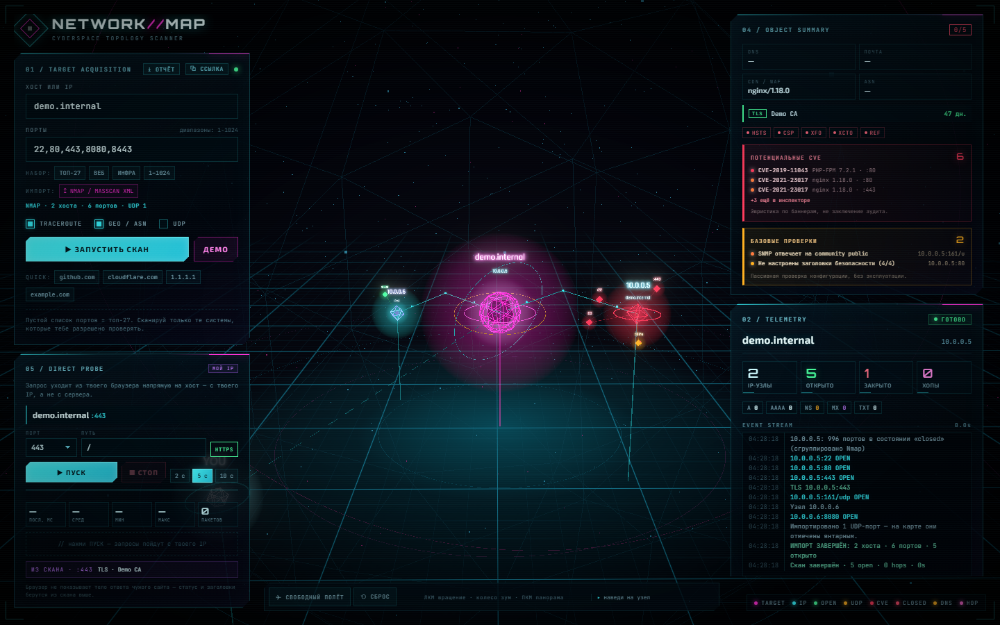

# NETWORK//MAP

**3D-карта сети в реальном времени.** Введи домен или IP, выбери порты — и топология соберётся в киберпанк-пространстве: DNS-серверы, IP-узлы, открытые порты, TLS-сертификаты, traceroute-маршрут и геоданные.

**Live:** https://network-map-3cw5.onrender.com


## Что умеет

- **DNS-разведка**: A, AAAA, CNAME, NS, MX, TXT, SOA, PTR (reverse DNS).
- **TCP-сканирование портов**: списки и диапазоны (`22,80,443,8000-8100`), до 1024 портов, таймауты и параллельные воркеры.
- **UDP-пробы**: опционально DNS (53), NTP (123), SNMP (161), mDNS (5353) и SSDP (1900) — открытые порты светятся янтарным.
- **CVE-подсказки**: версии OpenSSH, nginx, Apache, Exim, Samba и других сверяются с локальной базой известных уязвимостей — уязвимые узлы и порты подсвечиваются красным.
- **Базовые проверки**: открытые Telnet/FTP/RDP/SMB, Redis/MongoDB/Memcached/Docker, слабый TLS, просроченный сертификат, отсутствие security-заголовков и опасные UDP-сервисы — с уровнем риска и рекомендацией.
- **Сервисные отпечатки**: баннеры SSH/FTP/SMTP, HTTP-заголовки, title страницы, TLS-сертификат (issuer, SAN, срок действия, cipher).
- **Сводка по объекту**: DNS- и почтовый провайдер по NS/MX, CDN/WAF по заголовкам, ASN, состояние сертификата и HTTP-заголовки безопасности (HSTS, CSP, XFO, XCTO, Referrer-Policy).
- **Пресеты портов**: ТОП-27, ВЕБ, ИНФРА и 1–1024 одним тапом.
- **Ссылка на результат**: `?target=example.com&ports=80,443` открывает карту и сразу запускает скан.
- **Учёт лимита**: HUD показывает, сколько сканов осталось и когда освободится слот.
- **Прямая проба с твоего IP**: панель `05 / DIRECT PROBE` шлёт paced-запросы из браузера (не с сервера) и показывает задержку, порт, ответ и статистику.
- **Отчёт в один клик**: кнопка `⭳ ОТЧЁТ` выгружает HTML, JSON или PDF со всеми собранными данными — для аудита и пентеста.
- **Импорт Nmap / Masscan**: загрузи `.xml` — карта, порты, сервисы, TLS и HTTP-заголовки появятся без серверного скана и лимитов.
- **OSINT по поддоменам**: кнопка `⌕ НАЙТИ ПОДДОМЕНЫ` запрашивает Certificate Transparency (crt.sh) и строит вокруг ядра орбиту дочерних узлов; клик по имени запускает его скан. Имена из TLS SAN показываются даже без crt.sh.
- **Стек технологий**: Wappalyzer-лайт определяет CMS, фреймворки, серверы, CDN и аналитику по заголовкам, именам cookie, `<meta generator>` и HTML — бейджами в инспекторе и в отчёте.
- **Spotlight-поиск**: `Ctrl+K` ищет по IP, портам, сервисам, CVE, находкам и технологиям; остальные узлы тускнеют, камера подлетает к совпадениям.
- **Кластеры**: группировка узлов по `/24` (IPv6 — `/64`) или ASN в полупрозрачные сферы.
- **Packet Inspector**: клик по ребру «ядро → IP» показывает восстановленный HTTP-запрос и сырые заголовки ответа, TLS-параметры или баннер сервиса.
- **История и DIFF**: последние 20 сканов хранятся в IndexedDB; повторный скан показывает зелёным новые порты, красным — закрывшиеся и новые CVE.
- **Импорт httpx / nuclei**: JSONL-выгрузки `httpx -json` и `nuclei -jsonl` визуализируются вместе с технологиями и находками.
- **Traceroute**: маршрут до цели по хопам с задержками (через системный `tracert`/`traceroute`).
- **GEO / ASN**: город, страна, провайдер, автономная система для IP и хопов.
- **RDAP**: регистратор, организация, даты регистрации/истечения домена или IP-сети.
- **Живой 3D-мир**: узлы появляются по мере сканирования, по линиям летят пакеты, ядро пульсирует, порты светятся.
- **Свободная камера**: орбитальный обзор или полёт от первого лица (WASD + мышь).
- **Мобильный HUD**: нижняя панель со вкладками «Скан / Данные / Инспект», тап по узлу и touch-камера.
- **Инспектор**: клик по любому узлу — карточка со всеми деталями.
- **Демо-режим**: полноценная синтетическая топология без единого сетевого запроса.



## Быстрый старт

```bash
npm install

# разработка: Vite (5173) + API (8787)
npm run dev
# → http://localhost:5173

# production
npm run build
npm start
# → http://127.0.0.1:8787
```

Требуется Node.js 20+.

## Публичный доступ (Render)

GitHub Pages для этого проекта **не подойдёт**: он умеет отдавать только статику, а DNS/TCP/TLS/traceroute выполняет Node-бэкенд. Держи фронтенд и API вместе на Render — там HTTPS и публичный URL из коробки.

1. Залей проект на GitHub:

```bash
git init
git add .
git commit -m "Network map"
git branch -M main
git remote add origin https://github.com/<user>/<repo>.git
git push -u origin main
```

2. В [Render](https://render.com) → **New → Blueprint** → выбери репозиторий. Он прочитает `render.yaml` и создаст web-сервис.
3. После сборки сайт будет доступен по адресу `https://<service>.onrender.com`.

Можно и вручную: **New → Web Service**, Build Command `npm ci && npm run build`, Start Command `npm start`, Health Check Path `/api/health`, переменная `HOST=0.0.0.0`.

### Лимиты и переменные

| Переменная | По умолчанию | Назначение |
| --- | --- | --- |
| `SCAN_LIMIT` | `3` | Сканов в минуту с одного IP |
| `SCAN_WINDOW_MS` | `60000` | Окно лимита, мс |
| `DEMO_LIMIT` | `10` | Демо-запусков в минуту с IP |
| `MAX_ACTIVE_SCANS` | `4` | Одновременных сканов на весь сервер |
| `HOST` | `127.0.0.1` локально | На Render должно быть `0.0.0.0` |
| `CORS_ORIGIN` | — | Домены UI через запятую, если фронтенд отдельно |
| `VITE_API_BASE` | — | Абсолютный URL API при отдельной сборке UI |

При превышении лимита API отвечает `429` и заголовком `Retry-After`.

Нюансы Render:

- Free-инстанс засыпает после простоя — первый запрос может занять до минуты.
- Сканы идут с IP Render. Провайдер может ограничивать исходящие соединения или заблокировать сервис за жалобы на сканирование; лимиты и предупреждение ниже — обязательная минимальная защита.
- Для отдельного фронтенда задай `CORS_ORIGIN` на сервере и `VITE_API_BASE` при сборке.

## Управление

| Действие | Орбита | Полёт |
| --- | --- | --- |
| Вращение | ЛКМ | мышь (pointer lock) |
| Зум | колесо | — |
| Панорама | ПКМ | — |
| Движение | — | `WASD` |
| Вверх / вниз | — | `Space` / `C` |
| Ускорение | — | `Shift` |
| Выход | — | `Esc` |
| Выбор узла | клик | `Esc`, затем клик |
| Spotlight-поиск | `Ctrl`/`Cmd` + `K` | `Ctrl`/`Cmd` + `K` |

Сброс камеры — кнопка `⟲ СБРОС` внизу по центру.

Ссылка на скан — кнопка `⧉ ССЫЛКА`: копирует адрес вида `/?target=example.com&ports=80,443`, который сразу запускает сканирование у получателя.

### Мобильная версия

На узких экранах HUD превращается в нижнюю панель с четырьмя кнопками:

- **СКАН** — форма цели и портов;
- **ДАННЫЕ** — сводка по объекту (DNS/почта/CDN/TLS), статистика, DNS и живой лог;
- **ИНСПЕКТ** — карточка выбранного узла (открывается сама при тапе по узлу);
- **СБРОС** — вернуть камеру.

Повторный тап по активной вкладке сворачивает панель, чтобы освободить 3D-сцену. Камера на телефоне: один палец — вращение, два пальца — зум и панорама.


## Как это работает

```
web/ (React + three.js / R3F)
  └── POST /api/scan  ← NDJSON-поток событий
server/
  ├── scan.js  DNS → IP → порты → TLS/HTTP → traceroute → GEO/RDAP
  ├── index.js API, лимитеры и прокси crt.sh
  └── demo.js  сценарная демо-топология
```

Клиентские модули: `tech.ts` (правила стека), `search.ts` (Spotlight), `layout.ts` (кластеры и орбиты поддоменов), `history.ts` (IndexedDB + DIFF), `importers.ts` (Nmap/httpx/nuclei), `checks.ts` и `cve.ts` (пассивные проверки).

Сервер не ждёт окончания скана: каждое событие (`ip`, `port`, `tls`, `hop`, `geo`, …) сразу уходит в браузер, а клиент собирает из них 3D-граф. Поэтому карта растёт на глазах, а не появляется целиком в конце.

### API

`POST /api/scan`

```json
{
  "target": "github.com",
  "ports": "22,80,443,8000-8100",
  "traceroute": true,
  "geo": true,
  "udp": false
}
```

Ответ — `application/x-ndjson`, по одному JSON-событию на строку:

```json
{"type":"meta","host":"github.com","ports":[22,80,443],"udpPorts":[],...}
{"type":"dns","records":{"a":[...],"ns":[...],"mx":[...]}}
{"type":"ip","ip":"140.82.121.3","family":4,"primary":true}
{"type":"port","ip":"140.82.121.3","port":443,"protocol":"tcp","state":"open","rtt":7}
{"type":"tls","ip":"140.82.121.3","port":443,"subject":"github.com",...}
{"type":"hop","index":3,"ip":"...","rtt":14}
{"type":"done","stats":{"open":3,"scanned":3,...}}
```

`GET /api/demo` — тот же формат, но с заранее написанным сценарием.
`GET /api/health` — проверка сервера.
`GET /api/subdomains?host=example.com` — имена из Certificate Transparency через crt.sh: `{ host, total, subdomains[], truncated, cached }`. Ответ кэшируется на 10 минут, лимит — 20 запросов в минуту с IP, таймаут 15 с. При ошибке crt.sh сервер отвечает `502` с подсказкой, а клиент всё равно показывает имена из TLS SAN.

Каждый ответ `/api/scan` (включая `429`) содержит заголовки `RateLimit-Limit`, `RateLimit-Remaining` и `RateLimit-Reset` — HUD показывает по ним остаток квоты.

### UDP-пробы

Тумблер `UDP` в форме добавляет к TCP-скану пять базовых UDP-портов: **DNS 53**, **NTP 123**, **SNMP 161**, **mDNS 5353**, **SSDP 1900**. Сервер шлёт по одному корректному запросу на порт:

- **53** — DNS-запрос `A example.com`;
- **123** — NTP client packet (LI=0, VN=3, Mode=3);
- **161** — SNMPv1 `GetRequest` для `sysDescr.0` с community `public`;
- **5353** — mDNS-запрос `_services._dns-sd._udp.local` (PTR);
- **1900** — `M-SEARCH` для SSDP.

Если пришёл ответ — порт `open`, в баннере видно, что именно ответило (`DNS-ответ · 83 B · rcode 0`, `NTP v3 · stratum 3`). Если ответа нет — порт помечается `filtered` с честной подписью **open|filtered**: UDP не отличает закрытый порт от отфильтрованного файрволом. Пакеты принимаются только с адреса цели, чтобы случайный трафик не давал ложный `open`.

UDP-порты на карте янтарные (TCP — зелёные), в инспекторе и отчёте указан протокол. Сканируются только пять перечисленных портов и только на основном IP — это осознанное ограничение, чтобы не превращать фичу в UDP-флуд.

### Сводка по объекту

После скана панель `04 / OBJECT SUMMARY` собирает вывод из уже полученных событий, без дополнительных запросов:

- **DNS** — провайдер по NS (Cloudflare, Route 53, Yandex, REG.RU, …);
- **ПОЧТА** — провайдер по MX (Google Workspace, Microsoft 365, Mail.ru, …);
- **CDN / WAF** — Cloudflare, CloudFront, Akamai, Fastly, Vercel и другие по заголовкам;
- **ASN** — сеть и провайдер основного IP;
- **TLS** — издатель, протокол и дней до истечения (жёлтый при < 14 дней, красный при истечении);
- **заголовки безопасности** — HSTS, CSP, XFO, XCTO, Referrer-Policy и счётчик `N/5`.

### Прямая проба (DIRECT PROBE)

Панель `05 / DIRECT PROBE` отправляет HTTP(S)-запросы **из твоего браузера**, поэтому пакеты идут с твоего IP, а не с сервера Render. Что показывает:

- задержку каждого запроса (последняя, средняя, минимум, максимум);
- номер порта и схему (`HTTP`/`HTTPS`);
- результат: `ответ получен`, `таймаут` или `нет ответа`;
- «отпечаток из скана» для выбранного порта — HTTP-статус, `Server`, title или TLS-сертификат.

Запросы идут с настраиваемой паузой **2 / 5 / 10 секунд** с видимым таймером обратного отсчёта. За сессию — не больше **20 запросов**, после **3 ошибок подряд** проба останавливается сама. Это защита от блокировки твоего IP и от превращения фичи в флуд.

Что важно знать:

- браузер не отдаёт тело и заголовки чужого ответа при cross-origin запросе (`no-cors`), поэтому показываются время и сам факт ответа, а детали подтягиваются из скана;
- страница открыта по HTTPS, значит браузер заблокирует `http://`-запросы (mixed content): для пробы выбирай TLS-порт (443, 8443, 9443);
- это не ICMP `ping`: браузер умеет только HTTP(S), зато честно с твоего адреса.


### Отчёт (ЭКСПОРТ)

После скана в шапке панели `01 / TARGET ACQUISITION` появляется кнопка `⭳ ОТЧЁТ` с тремя форматами:

- **HTML** — один самодостаточный файл: сводка по объекту, DNS, TLS, заголовки безопасности, все IP с портами и баннерами, маршрут, RDAP и журнал. Открывается в любом браузере и печатается.
- **PDF** — открывается системный диалог печати, где выбирается «Сохранить как PDF». Отчёт свёрстан под A4: таблицы не рвутся, лишние панели и кнопки не печатаются.
- **JSON** — те же данные в машинном виде: `tool`, `generatedAt`, `target`, `host`, `stats`, `summary`, `dns`, `rdap`, `ips[]` (порты, TLS, HTTP-заголовки), `cves[]`, `findings[]`, `hops[]`, `logs[]`. Удобно для скриптов и сравнения сканов.

Всё формируется **в браузере**: сервер не хранит результаты и не получает их повторно.


### Импорт Nmap / Masscan, httpx и nuclei

Кнопка `↥ XML · HTTPX · NUCLEI` под пресетами портов открывает выбор файла. Что происходит:

- **Nmap / Masscan XML** разбирается в браузере: `host` → узлы карты, `port` → порты со состояниями `open`/`closed`/`filtered`, `http-title`, `http-headers` и `ssl-cert` — в те же HTTP/TLS-карточки, что и при живом скане. Поддерживается и `<nmaprun scanner="masscan">`.
- **httpx JSONL** (`httpx -json`) создаёт узлы по `ip`/`host`, открытые порты и HTTP-ответы; поля `tech`, `webserver`, `title`, `header` сразу попадают в бейджи технологий.
- **nuclei JSONL** (`nuclei -jsonl`) добавляет находки по `template-id`, `info.severity` и `matched-at`; CVE-шаблоны становятся CVE-находками, остальные — базовыми findings.
- `hostname` становится PTR, узел — целью отчёта; после импорта работают инспектор, сводка, DIFF и экспорт отчёта.

Ограничения: до **512 хостов** и **20 000 портов** на файл, размер файла до **32 МБ**. Импортируются и TCP-, и UDP-порты: UDP отмечены протоколом в таблице и янтарным цветом на карте. Всё разбирается локально, файл не загружается на сервер.


### CVE-подсказки

Если в баннере сервиса или HTTP-заголовках видна версия, карта сверяет её с **локальной базой** известных уязвимостей. База лежит в `web/src/cve.ts` и не делает внешних запросов:

- **OpenSSH** — CVE-2024-6387 (regreSSHion) и CVE-2018-15473;
- **nginx** — CVE-2021-23017 и CVE-2022-41741;
- **Apache httpd** — CVE-2021-41773;
- **vsftpd**, **ProFTPD**, **Exim**, **Samba**, **Grafana**, **Elasticsearch** — по одной характерной RCE;
- **PHP** — CVE-2019-11043 (по `X-Powered-By`, с оговоркой про PHP-FPM);
- **OpenSSL** — Heartbleed (CVE-2014-0160).

Совпадения видны сразу: уязвимый узел и его порты подсвечиваются красным, в `OBJECT SUMMARY` появляется блок `ПОТЕНЦИАЛЬНЫЕ CVE`, а в инспекторе — уровень, описание, версия исправления и оговорки. В HTML-отчёт попадает отдельная таблица с предупреждением, в JSON — массив `cves[]`.

**Это эвристика, а не аудит.** Версия из баннера может быть неточной, патч мог быть применён без смены версии, а условие эксплуатации — не выполняться. Совпадение означает «стоит проверить вручную», а не «уязвимость подтверждена». Для точной проверки нужны аутентифицированные сканеры и ручной анализ.



### Базовые проверки

Кроме CVE по версиям, карта отмечает типовые мисконфигурации — тоже без эксплуатации и без лишних запросов:

- **опасные сервисы на периметре** — Telnet, FTP, RDP, VNC, SMB, Redis, MongoDB, Memcached, Elasticsearch, Docker API, Kubernetes API, LDAP, NFS, rsync, SOCKS, ADB и открытые СУБД;
- **TLS** — истёкший или скоро истекающий сертификат, TLS 1.0/1.1, слабый шифр (RC4/3DES/NULL/EXPORT), самоподписанный сертификат, несовпадение с именем хоста;
- **HTTP** — отсутствие HSTS, CSP, X-Frame-Options, X-Content-Type-Options и Referrer-Policy, а также HTTP без HTTPS;
- **UDP** — DNS-ответы из интернета, SNMP с community `public`, mDNS, SSDP и NTP.

У каждой находки есть уровень, узел/порт, короткое объяснение и рекомендация. Они видны в `OBJECT SUMMARY`, в инспекторе выбранного узла/порта и в отчёте: отдельная таблица в HTML и массив `findings[]` в JSON.

**Это пассивная проверка конфигурации.** Она не подбирает пароли, не ходит по скрытым путям и не эксплуатирует уязвимости. Находка означает «так быть не должно / стоит проверить», а не подтверждённую компрометацию.



### OSINT и работа с графом

**Поддомены.** Кнопка `⌕ НАЙТИ ПОДДОМЕНЫ` в панели `06 / SUBDOMAINS` делает один запрос к `GET /api/subdomains`, а сервер — к crt.sh. Найденные имена (до 200) появляются вокруг ядра отдельной орбитой: клик по узлу или по имени в списке запускает его скан с текущими портами. Если crt.sh недоступен, панель показывает ошибку, но имена из TLS SAN, уже полученные сканом, остаются на карте и в списке с меткой `CT`. Для IP-целей поиск недоступен — только TLS SAN в инспекторе.

**Стек технологий.** `web/src/tech.ts` содержит около 90 правил: CMS (WordPress, Bitrix, Drupal, Tilda…), ecommerce, фреймворки (Next.js, React, Vue, Laravel, Django…), серверы и edge (nginx, Apache, IIS, Cloudflare, Vercel…), аналитика и security. Сигналы — заголовки, **имена** cookie (значения не сохраняются), `<meta generator>` и первые 16 КБ HTML. Результат — цветные бейджи в инспекторе и таблица в HTML/JSON-отчёте. Всё считается в браузере, дополнительных запросов нет.

**Spotlight.** `Ctrl+K` (или кнопка `⌕ SPOTLIGHT`, или `⌕ ПОИСК` внизу) открывает оверлей. Поиск идёт по IP, PTR, городу, ASN, портам, протоколам, сервисам, баннерам, CVE, находкам, технологиям, хопам, NS и MX. Совпадения ранжируются, `↑`/`↓` + `Enter` открывают инспектор, остальные узлы тускнеют, камера плавно подлетает к найденным. Сброс фокуса — кнопка `✕ СБРОС` в плашке сверху.

**Кластеры.** В телеметрии переключатель `КЛАСТЕРЫ: ВЫКЛ / /24 / ASN`. При трёх и более узлах карта раскладывает их вокруг центров групп и рисует wireframe-сферы с подписью и количеством. `/24` работает и для IPv6 (`/64`), ASN берётся из GEO/ASN.

**Packet Inspector.** Клик по ребру «ядро → IP» открывает инспектор связи. Для HTTP показывается восстановленный запрос (`GET / HTTP/1.1`, Host, User-Agent…) и реальные заголовки ответа, для TLS — параметры рукопожатия, для остальных портов — баннер сервиса. Это уже собранные сканом данные, без повторных запросов; тела ответов и cookie-значения не сохраняются.

**История и DIFF.** Каждый завершённый скан (включая импорт) сохраняется в IndexedDB `network-map-history` — до 20 записей на браузер. Повторный скан того же хоста показывает панель `08 / HISTORY · DIFF`: зелёным новые открытые порты, красным закрывшиеся, новые CVE и находки, серым — неизменённую часть. История не покидает браузер; кнопка `ОЧИСТИТЬ` удаляет её.

**Direct Connect.** В карточке открытого порта есть кнопки быстрого перехода: для `80`/`443` — «Открыть в браузере» и «Открыть в Burp» (URL копируется в буфер, дальше вставь его в Burp Repeater через `Ctrl+R`), для `22` — копирование готовой команды `ssh user@host`, для `3389` — скачивание `.rdp`-файла с адресом и портом. Всё строится локально из данных скана; для домена берётся его имя (чтобы виртуальные хосты ответили правильно), для IP — сам адрес.

### Внешние источники

- **GEO**: [ipwho.is](https://ipwho.is) с резервным [ip-api.com](http://ip-api.com).
- **RDAP**: [rdap.org](https://rdap.org).
- **Certificate Transparency**: [crt.sh](https://crt.sh) через серверный прокси с кэшем 10 минут и лимитом 20 запросов в минуту.
- **Traceroute**: системные `tracert` (Windows) или `traceroute` (Linux/macOS). Если утилиты нет (например, в контейнере Render), маршрут строится через бесплатный [Globalping](https://globalping.io) с немецкого пробника.

Без интернета карта всё равно работает: DNS/порты/TLS/HTTP проверяются напрямую, а GEO и RDAP просто не появятся.

## Ограничения

- TCP-порты сканируются всегда; UDP — только пять базовых портов и только по тумблеру `UDP`.
- Максимум **1024 порта** за один скан, **4 одновременных скана** на сервер и **3 скана в минуту** с одного IP.
- Точность и скорость зависят от сети, файрвола и провайдера. `filtered` означает «нет ответа», а не «порт закрыт».
- Traceroute — это внешняя утилита; на некоторых системах она может быть недоступна или требовать прав.
- CVE-подсказки — эвристика по версиям из баннеров, без обращений к NVD и без проверки эксплойтов. Это не заключение аудита.
- Базовые проверки пассивны: они оценивают открытые порты, баннеры, TLS и HTTP-заголовки, но не проверяют аутентификацию и не эксплуатируют найденное.
- Определение стека и Packet Inspector работают по уже собранным сигналам: тело ответа не хранится целиком, cookie — только по именам. Это эвристика, а не Wappalyzer с полной базой.
- Поддомены зависят от crt.sh: сервис может быть медленным или недоступным, тогда показываются только имена из TLS SAN. У crt.sh нет гарантии полноты — это публичные логи, а не зона DNS.
- История и DIFF живут только в текущем браузере (IndexedDB). В приватном режиме или при очистке данных они исчезают; при недоступности IndexedDB остаётся копия в памяти до перезагрузки.
- IPv6-узлы сканируются, только если у машины есть рабочий IPv6-маршрут.
- GEO/RDAP — внешние бесплатные сервисы с лимитами; при недоступности данные просто пропускаются.

## Безопасность и этика

Инструмент запускается **локально** и подключается к указанным хостам напрямую с твоей машины. Используй его только против систем, на проверку которых у тебя есть разрешение. Не выставляй сервер в публичный интернет без аутентификации и ограничений: это фактически сканер портов.

## Идеи для развития

- ASN/BGP-граф и визуализация маршрутов между автономными системами.
- Гео-координаты узлов на 3D-глобусе.
- История сканов и сравнение топологии во времени.
- WebSocket + совместный просмотр карты.
- UDP-пробы, HTTP/2, TLS SAN-граф, favicon-хеши.
- Импорт `nmap`/`masscan` XML и pcap.

---

Сделано как эксперимент на стыке network diagnostics и cyberpunk-визуализации.# Network-map
