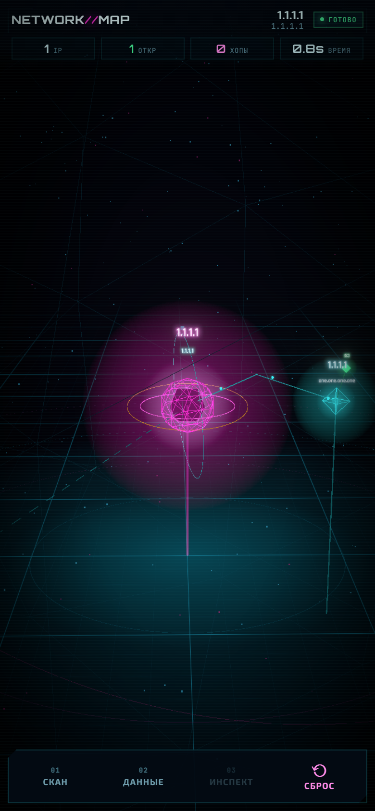
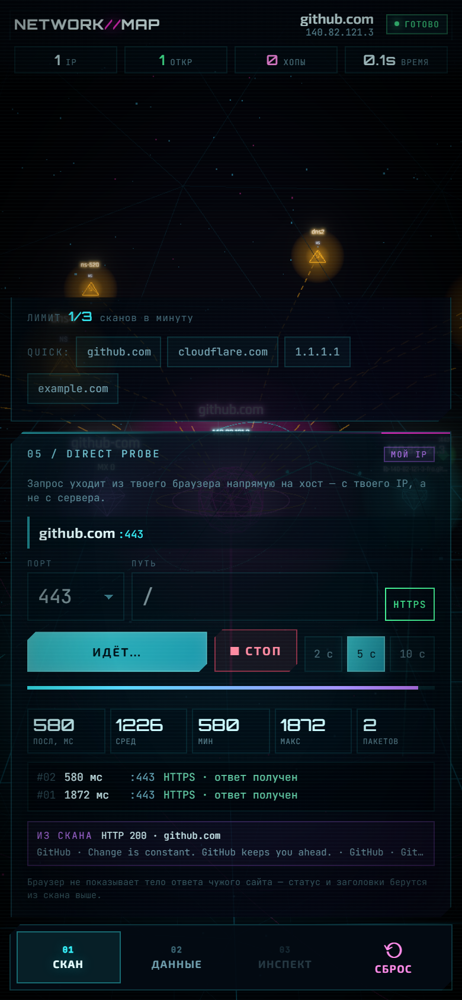
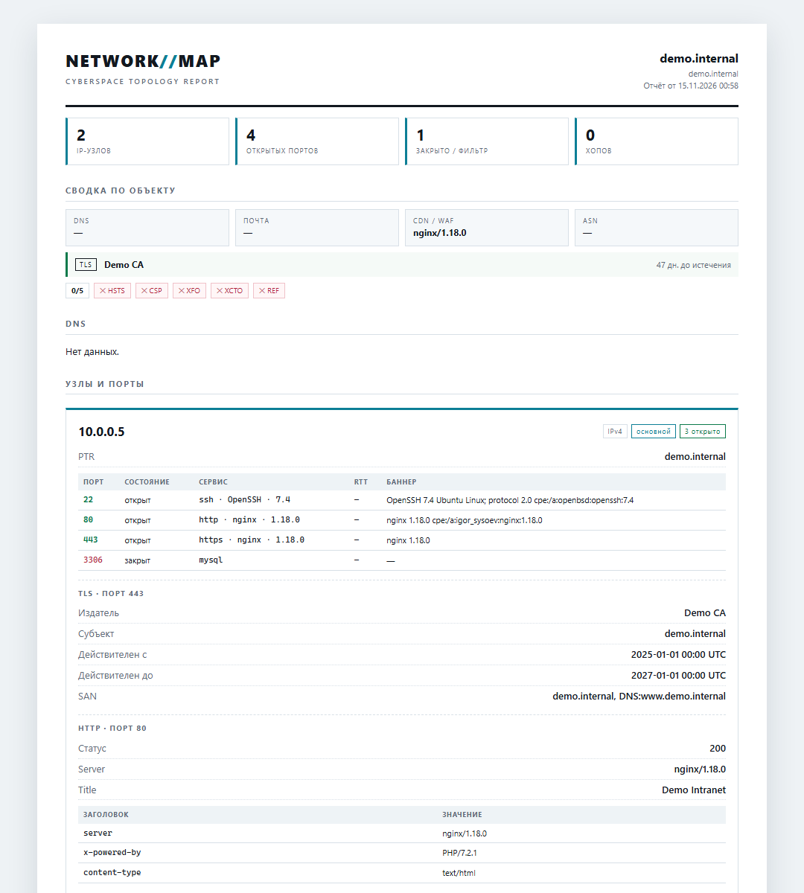
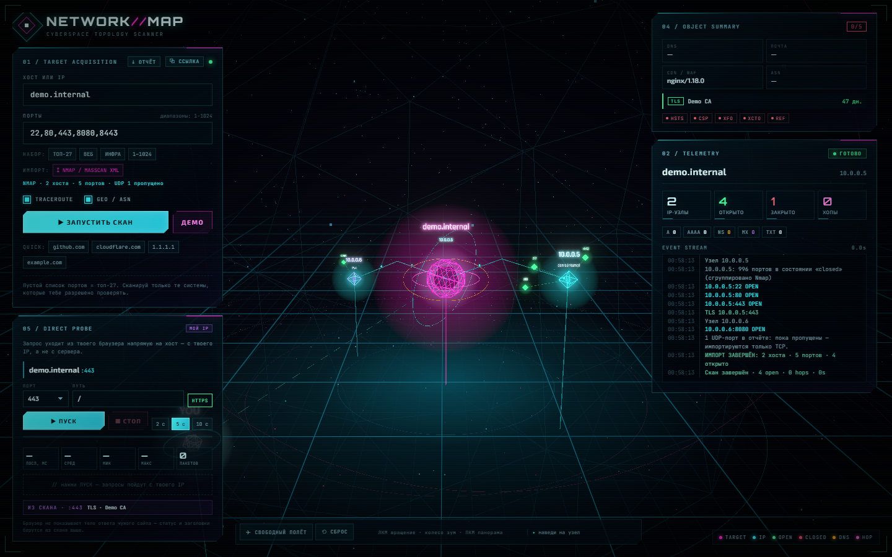

# NETWORK//MAP

**3D-карта сети в реальном времени.** Введи домен или IP, выбери порты — и топология соберётся в киберпанк-пространстве: DNS-серверы, IP-узлы, открытые порты, TLS-сертификаты, traceroute-маршрут и геоданные.

**Live:** https://network-map-3cw5.onrender.com


## Что умеет

- **DNS-разведка**: A, AAAA, CNAME, NS, MX, TXT, SOA, PTR (reverse DNS).
- **TCP-сканирование портов**: списки и диапазоны (`22,80,443,8000-8100`), до 1024 портов, таймауты и параллельные воркеры.
- **Сервисные отпечатки**: баннеры SSH/FTP/SMTP, HTTP-заголовки, title страницы, TLS-сертификат (issuer, SAN, срок действия, cipher).
- **Сводка по объекту**: DNS- и почтовый провайдер по NS/MX, CDN/WAF по заголовкам, ASN, состояние сертификата и HTTP-заголовки безопасности (HSTS, CSP, XFO, XCTO, Referrer-Policy).
- **Пресеты портов**: ТОП-27, ВЕБ, ИНФРА и 1–1024 одним тапом.
- **Ссылка на результат**: `?target=example.com&ports=80,443` открывает карту и сразу запускает скан.
- **Учёт лимита**: HUD показывает, сколько сканов осталось и когда освободится слот.
- **Прямая проба с твоего IP**: панель `05 / DIRECT PROBE` шлёт paced-запросы из браузера (не с сервера) и показывает задержку, порт, ответ и статистику.
- **Отчёт в один клик**: кнопка `⭳ ОТЧЁТ` выгружает HTML, JSON или PDF со всеми собранными данными — для аудита и пентеста.
- **Импорт Nmap / Masscan**: загрузи `.xml` — карта, порты, сервисы, TLS и HTTP-заголовки появятся без серверного скана и лимитов.
- **Traceroute**: маршрут до цели по хопам с задержками (через системный `tracert`/`traceroute`).
- **GEO / ASN**: город, страна, провайдер, автономная система для IP и хопов.
- **RDAP**: регистратор, организация, даты регистрации/истечения домена или IP-сети.
- **Живой 3D-мир**: узлы появляются по мере сканирования, по линиям летят пакеты, ядро пульсирует, порты светятся.
- **Свободная камера**: орбитальный обзор или полёт от первого лица (WASD + мышь).
- **Мобильный HUD**: нижняя панель со вкладками «Скан / Данные / Инспект», тап по узлу и touch-камера.
- **Инспектор**: клик по любому узлу — карточка со всеми деталями.
- **Демо-режим**: полноценная синтетическая топология без единого сетевого запроса.


## Быстрый старт

```bash
npm install

# разработка: Vite (5173) + API (8787)
npm run dev
# → http://localhost:5173

# production
npm run build
npm start
# → http://127.0.0.1:8787
```

Требуется Node.js 20+.

## Публичный доступ (Render)

GitHub Pages для этого проекта **не подойдёт**: он умеет отдавать только статику, а DNS/TCP/TLS/traceroute выполняет Node-бэкенд. Держи фронтенд и API вместе на Render — там HTTPS и публичный URL из коробки.

1. Залей проект на GitHub:

```bash
git init
git add .
git commit -m "Network map"
git branch -M main
git remote add origin https://github.com/<user>/<repo>.git
git push -u origin main
```

2. В [Render](https://render.com) → **New → Blueprint** → выбери репозиторий. Он прочитает `render.yaml` и создаст web-сервис.
3. После сборки сайт будет доступен по адресу `https://<service>.onrender.com`.

Можно и вручную: **New → Web Service**, Build Command `npm ci && npm run build`, Start Command `npm start`, Health Check Path `/api/health`, переменная `HOST=0.0.0.0`.

### Лимиты и переменные

| Переменная | По умолчанию | Назначение |
| --- | --- | --- |
| `SCAN_LIMIT` | `3` | Сканов в минуту с одного IP |
| `SCAN_WINDOW_MS` | `60000` | Окно лимита, мс |
| `DEMO_LIMIT` | `10` | Демо-запусков в минуту с IP |
| `MAX_ACTIVE_SCANS` | `4` | Одновременных сканов на весь сервер |
| `HOST` | `127.0.0.1` локально | На Render должно быть `0.0.0.0` |
| `CORS_ORIGIN` | — | Домены UI через запятую, если фронтенд отдельно |
| `VITE_API_BASE` | — | Абсолютный URL API при отдельной сборке UI |

При превышении лимита API отвечает `429` и заголовком `Retry-After`.

Нюансы Render:

- Free-инстанс засыпает после простоя — первый запрос может занять до минуты.
- Сканы идут с IP Render. Провайдер может ограничивать исходящие соединения или заблокировать сервис за жалобы на сканирование; лимиты и предупреждение ниже — обязательная минимальная защита.
- Для отдельного фронтенда задай `CORS_ORIGIN` на сервере и `VITE_API_BASE` при сборке.

## Управление

| Действие | Орбита | Полёт |
| --- | --- | --- |
| Вращение | ЛКМ | мышь (pointer lock) |
| Зум | колесо | — |
| Панорама | ПКМ | — |
| Движение | — | `WASD` |
| Вверх / вниз | — | `Space` / `C` |
| Ускорение | — | `Shift` |
| Выход | — | `Esc` |
| Выбор узла | клик | `Esc`, затем клик |

Сброс камеры — кнопка `⟲ СБРОС` внизу по центру.

Ссылка на скан — кнопка `⧉ ССЫЛКА`: копирует адрес вида `/?target=example.com&ports=80,443`, который сразу запускает сканирование у получателя.

### Мобильная версия

На узких экранах HUD превращается в нижнюю панель с четырьмя кнопками:

- **СКАН** — форма цели и портов;
- **ДАННЫЕ** — сводка по объекту (DNS/почта/CDN/TLS), статистика, DNS и живой лог;
- **ИНСПЕКТ** — карточка выбранного узла (открывается сама при тапе по узлу);
- **СБРОС** — вернуть камеру.

Повторный тап по активной вкладке сворачивает панель, чтобы освободить 3D-сцену. Камера на телефоне: один палец — вращение, два пальца — зум и панорама.



## Как это работает

```
web/ (React + three.js / R3F)
  └── POST /api/scan  ← NDJSON-поток событий
server/
  ├── scan.js  DNS → IP → порты → TLS/HTTP → traceroute → GEO/RDAP
  └── demo.js  сценарная демо-топология
```

Сервер не ждёт окончания скана: каждое событие (`ip`, `port`, `tls`, `hop`, `geo`, …) сразу уходит в браузер, а клиент собирает из них 3D-граф. Поэтому карта растёт на глазах, а не появляется целиком в конце.

### API

`POST /api/scan`

```json
{
  "target": "github.com",
  "ports": "22,80,443,8000-8100",
  "traceroute": true,
  "geo": true
}
```

Ответ — `application/x-ndjson`, по одному JSON-событию на строку:

```json
{"type":"meta","host":"github.com","ports":[22,80,443],...}
{"type":"dns","records":{"a":[...],"ns":[...],"mx":[...]}}
{"type":"ip","ip":"140.82.121.3","family":4,"primary":true}
{"type":"port","ip":"140.82.121.3","port":443,"state":"open","rtt":7}
{"type":"tls","ip":"140.82.121.3","port":443,"subject":"github.com",...}
{"type":"hop","index":3,"ip":"...","rtt":14}
{"type":"done","stats":{"open":3,"scanned":3,...}}
```

`GET /api/demo` — тот же формат, но с заранее написанным сценарием.
`GET /api/health` — проверка сервера.

Каждый ответ `/api/scan` (включая `429`) содержит заголовки `RateLimit-Limit`, `RateLimit-Remaining` и `RateLimit-Reset` — HUD показывает по ним остаток квоты.

### Сводка по объекту

После скана панель `04 / OBJECT SUMMARY` собирает вывод из уже полученных событий, без дополнительных запросов:

- **DNS** — провайдер по NS (Cloudflare, Route 53, Yandex, REG.RU, …);
- **ПОЧТА** — провайдер по MX (Google Workspace, Microsoft 365, Mail.ru, …);
- **CDN / WAF** — Cloudflare, CloudFront, Akamai, Fastly, Vercel и другие по заголовкам;
- **ASN** — сеть и провайдер основного IP;
- **TLS** — издатель, протокол и дней до истечения (жёлтый при < 14 дней, красный при истечении);
- **заголовки безопасности** — HSTS, CSP, XFO, XCTO, Referrer-Policy и счётчик `N/5`.

### Прямая проба (DIRECT PROBE)

Панель `05 / DIRECT PROBE` отправляет HTTP(S)-запросы **из твоего браузера**, поэтому пакеты идут с твоего IP, а не с сервера Render. Что показывает:

- задержку каждого запроса (последняя, средняя, минимум, максимум);
- номер порта и схему (`HTTP`/`HTTPS`);
- результат: `ответ получен`, `таймаут` или `нет ответа`;
- «отпечаток из скана» для выбранного порта — HTTP-статус, `Server`, title или TLS-сертификат.

Запросы идут с настраиваемой паузой **2 / 5 / 10 секунд** с видимым таймером обратного отсчёта. За сессию — не больше **20 запросов**, после **3 ошибок подряд** проба останавливается сама. Это защита от блокировки твоего IP и от превращения фичи в флуд.

Что важно знать:

- браузер не отдаёт тело и заголовки чужого ответа при cross-origin запросе (`no-cors`), поэтому показываются время и сам факт ответа, а детали подтягиваются из скана;
- страница открыта по HTTPS, значит браузер заблокирует `http://`-запросы (mixed content): для пробы выбирай TLS-порт (443, 8443, 9443);
- это не ICMP `ping`: браузер умеет только HTTP(S), зато честно с твоего адреса.



### Отчёт (ЭКСПОРТ)

После скана в шапке панели `01 / TARGET ACQUISITION` появляется кнопка `⭳ ОТЧЁТ` с тремя форматами:

- **HTML** — один самодостаточный файл: сводка по объекту, DNS, TLS, заголовки безопасности, все IP с портами и баннерами, маршрут, RDAP и журнал. Открывается в любом браузере и печатается.
- **PDF** — открывается системный диалог печати, где выбирается «Сохранить как PDF». Отчёт свёрстан под A4: таблицы не рвутся, лишние панели и кнопки не печатаются.
- **JSON** — те же данные в машинном виде: `tool`, `generatedAt`, `target`, `host`, `stats`, `summary`, `dns`, `rdap`, `ips[]` (порты, TLS, HTTP-заголовки), `hops[]`, `logs[]`. Удобно для скриптов и сравнения сканов.

Всё формируется **в браузере**: сервер не хранит результаты и не получает их повторно.



### Импорт Nmap / Masscan XML

Кнопка `↥ NMAP / MASSCAN XML` под пресетами портов открывает выбор файла. Что происходит:

- XML разбирается в браузере, ничего не загружается на сервер;
- `host` → узлы карты, `port` → порты со состояниями `open`/`closed`/`filtered`, `service` → сервис, продукт и версия;
- `http-title`, `http-headers` и `ssl-cert` превращаются в те же HTTP/TLS-карточки, что и при живом скане;
- `hostname` становится PTR, узел — целью отчёта;
- после импорта работают инспектор, сводка и экспорт отчёта.

Ограничения: до **512 хостов** и **20 000 портов** на файл, размер файла до **32 МБ**. Пока импортируются только **TCP**-порты: UDP-записи пропускаются и попадают в журнал. Отчёт Masscan (`<nmaprun scanner="masscan">`) поддерживается тем же парсером.



### Внешние источники

- **GEO**: [ipwho.is](https://ipwho.is) с резервным [ip-api.com](http://ip-api.com).
- **RDAP**: [rdap.org](https://rdap.org).
- **Traceroute**: системные `tracert` (Windows) или `traceroute` (Linux/macOS). Если утилиты нет (например, в контейнере Render), маршрут строится через бесплатный [Globalping](https://globalping.io) с немецкого пробника.

Без интернета карта всё равно работает: DNS/порты/TLS/HTTP проверяются напрямую, а GEO и RDAP просто не появятся.

## Ограничения

- Сканируются только **TCP-порты**. UDP (DNS, SNMP, QUIC) не проверяется.
- Максимум **1024 порта** за один скан, **4 одновременных скана** на сервер и **3 скана в минуту** с одного IP.
- Точность и скорость зависят от сети, файрвола и провайдера. `filtered` означает «нет ответа», а не «порт закрыт».
- Traceroute — это внешняя утилита; на некоторых системах она может быть недоступна или требовать прав.
- IPv6-узлы сканируются, только если у машины есть рабочий IPv6-маршрут.
- GEO/RDAP — внешние бесплатные сервисы с лимитами; при недоступности данные просто пропускаются.

## Безопасность и этика

Инструмент запускается **локально** и подключается к указанным хостам напрямую с твоей машины. Используй его только против систем, на проверку которых у тебя есть разрешение. Не выставляй сервер в публичный интернет без аутентификации и ограничений: это фактически сканер портов.

## Идеи для развития

- ASN/BGP-граф и визуализация маршрутов между автономными системами.
- Гео-координаты узлов на 3D-глобусе.
- История сканов и сравнение топологии во времени.
- WebSocket + совместный просмотр карты.
- UDP-пробы, HTTP/2, TLS SAN-граф, favicon-хеши.
- Импорт `nmap`/`masscan` XML и pcap.

---

Сделано как эксперимент на стыке network diagnostics и cyberpunk-визуализации.# Network-map
