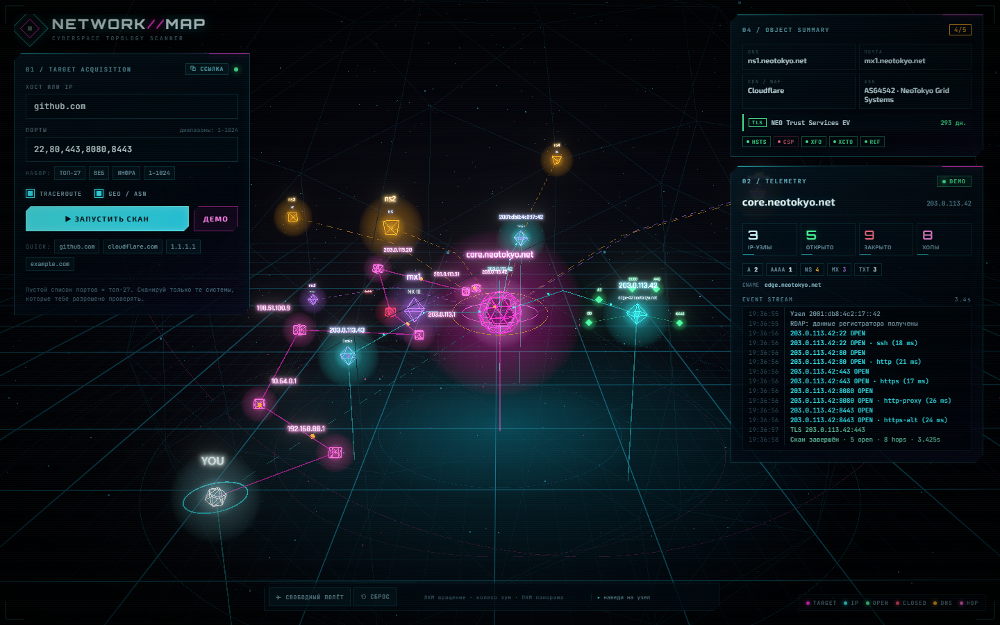

# NETWORK//MAP

**3D-карта сети в реальном времени.** Введи домен или IP, выбери порты — и топология соберётся в киберпанк-пространстве: DNS-серверы, IP-узлы, открытые порты, TLS-сертификаты, traceroute-маршрут и геоданные.

**Live:** https://network-map-3cw5.onrender.com



## Что умеет

- **DNS-разведка**: A, AAAA, CNAME, NS, MX, TXT, SOA, PTR (reverse DNS).
- **TCP-сканирование портов**: списки и диапазоны (`22,80,443,8000-8100`), до 1024 портов, таймауты и параллельные воркеры.
- **UDP-пробы**: опционально DNS (53), NTP (123), SNMP (161), mDNS (5353) и SSDP (1900) — открытые порты светятся янтарным.
- **CVE-подсказки**: версии OpenSSH, nginx, Apache, Exim, Samba и других сверяются с локальной базой известных уязвимостей — уязвимые узлы и порты подсвечиваются красным.
- **Базовые проверки**: открытые Telnet/FTP/RDP/SMB, Redis/MongoDB/Memcached/Docker, слабый TLS, просроченный сертификат, отсутствие security-заголовков и опасные UDP-сервисы — с уровнем риска и рекомендацией.
- **Сервисные отпечатки**: баннеры SSH/FTP/SMTP, HTTP-заголовки, title страницы, TLS-сертификат (issuer, SAN, срок действия, cipher).
- **Сводка по объекту**: DNS- и почтовый провайдер по NS/MX, CDN/WAF по заголовкам, ASN, состояние сертификата и HTTP-заголовки безопасности (HSTS, CSP, XFO, XCTO, Referrer-Policy).
- **Пресеты портов**: ТОП-27, ВЕБ, ИНФРА и 1–1024 одним тапом.
- **Ссылка на результат**: `?target=example.com&ports=80,443` открывает карту и сразу запускает скан.
- **Учёт лимита**: HUD показывает, сколько сканов осталось и когда освободится слот.
- **Прямая проба с твоего IP**: панель `05 / DIRECT PROBE` шлёт paced-запросы из браузера (не с сервера) и показывает задержку, порт, ответ и статистику.
- **Отчёт в один клик**: кнопка `⭳ ОТЧЁТ` выгружает HTML, JSON или PDF со всеми собранными данными — для аудита и пентеста.
- **Импорт Nmap / Masscan**: загрузи `.xml` — карта, порты, сервисы, TLS и HTTP-заголовки появятся без серверного скана и лимитов.
- **OSINT по поддоменам**: кнопка `⌕ НАЙТИ ПОДДОМЕНЫ` запрашивает Certificate Transparency (crt.sh) и строит вокруг ядра орбиту дочерних узлов; клик по имени запускает его скан. Имена из TLS SAN показываются даже без crt.sh.
- **Стек технологий**: Wappalyzer-лайт определяет CMS, фреймворки, серверы, CDN и аналитику по заголовкам, именам cookie, `<meta generator>` и HTML — бейджами в инспекторе и в отчёте.
- **Spotlight-поиск**: `Ctrl+K` ищет по IP, портам, сервисам, CVE, находкам и технологиям; остальные узлы тускнеют, камера подлетает к совпадениям.
- **Кластеры**: группировка узлов по `/24` (IPv6 — `/64`) или ASN в полупрозрачные сферы.
- **Packet Inspector**: клик по ребру «ядро → IP» показывает восстановленный HTTP-запрос и сырые заголовки ответа, TLS-параметры или баннер сервиса.
- **История и DIFF**: последние 20 сканов хранятся в IndexedDB; повторный скан показывает зелёным новые порты, красным — закрывшиеся и новые CVE.
- **Импорт httpx / nuclei**: JSONL-выгрузки `httpx -json` и `nuclei -jsonl` визуализируются вместе с технологиями и находками.
- **Traceroute**: маршрут до цели по хопам с задержками (через системный `tracert`/`traceroute`).
- **GEO / ASN**: город, страна, провайдер, автономная система для IP и хопов.
- **RDAP**: регистратор, организация, даты регистрации/истечения домена или IP-сети.
- **Живой 3D-мир**: узлы появляются по мере сканирования, по линиям летят пакеты, ядро пульсирует, порты светятся.
- **Свободная камера**: орбитальный обзор или полёт от первого лица (WASD + мышь).
- **Мобильный HUD**: нижняя панель со вкладками «Скан / Данные / Инспект», тап по узлу и touch-камера.
- **Инспектор**: клик по любому узлу — карточка со всеми деталями.
- **Демо-режим**: полноценная синтетическая топология без единого сетевого запроса.


## Быстрый старт

```bash
npm install

# разработка: Vite (5173) + API (8787)
npm run dev
# → http://localhost:5173

# production
npm run build
npm start
# → http://127.0.0.1:8787
```

Требуется Node.js 20+.

Серверный мониторинг периметра и алерты в Telegram/Discord — [docs/MONITORING.md](docs/MONITORING.md).
Сайт можно добавить в мониторинг, просто отправив его боту в личные сообщения: `/add example.com`.
